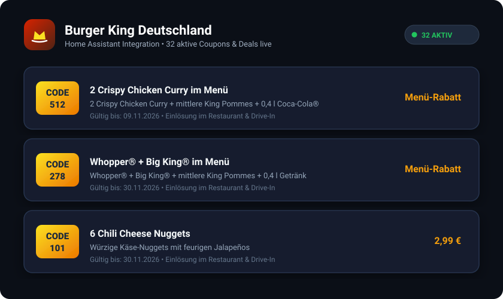

# Burger King Integration für Home Assistant

[](https://github.com/fboulegue/ha-burgerking/actions/workflows/validate.yml)
[](https://github.com/hacs/integration)
[](https://github.com/fboulegue/ha-burgerking/releases)
[](https://opensource.org/licenses/MIT)
[](https://github.com/fboulegue/ha-burgerking)

Offizielle Home Assistant Custom Integration für alle aktuellen **Burger King® Coupons, Deals und Aktionen**.

<p align="center">
  
</p>

---

## ✨ Features

- 🍔 **Jeder Gutschein als eigene Entität**: Jeder aktive Coupon erhält einen eigenen Sensor (`sensor.burger_king_coupon_<id>`).
- 🔢 **Coupon-Code als Zustand**: Der Gutscheincode bzw. die PLU (z.B. `512`, `278`, `101`) ist der Hauptzustand des Sensors – sofort ablesbar für Drive-In oder Kasse.
- 🖼️ **Offizielle Produktbilder**: Hochauflösende Burger- und Menübilder aus dem Burger King Sanity-CDN werden automatisch als `entity_picture` in Home Assistant angezeigt.
- 💶 **Preise & Rabatte**: Exakte Aktionspreise (z.B. `2,99 €`) oder Menü-Rabattangaben.
- 📅 **Gültigkeitszeitraum**: Anzeige von Start- und Ablaufdatum (`valid_until`).
- 📦 **Kein Login erforderlich**: Alle Coupons werden direkt live über das Burger King GraphQL-Gateway bezogen – 100% anonym, ohne Account oder Zugangsdaten.
- 🔄 **Automatische Updates**: Sobald neue Gutscheine erscheinen oder alte ablaufen, aktualisiert die Integration alle Entitäten automatisch.
- 📊 **Übersichtssensor**: `sensor.burger_king_aktive_coupons` liefert die Gesamtzahl und alle Coupons als strukturiertes JSON-Attribut für Dashboards.

---

## 📦 Entitäten & Attribute

### Einzelner Coupon (`sensor.burger_king_coupon_<id>`)

| Attribut | Typ | Beispiel | Beschreibung |
|---|---|---|---|
| **Zustand** | String | `512` | Der Gutscheincode / PLU zur Einlösung |
| `title` | String | `2 Crispy Chicken Curry im Menü` | Produktname / Titel |
| `items` | String | `2 Crispy Chicken Curry + mittlere Pommes + 0,4 l Coca-Cola®` | Enthaltene Produkte |
| `price` | String | `Menü-Rabatt` oder `2,99 €` | Aktionspreis |
| `valid_until`| Date | `2026-11-09` | Gültig bis einschließlich |
| `valid_from` | Date | `2026-09-15` | Gültig ab |
| `entity_picture`| URL | `https://cdn.sanity.io/...png` | Offizielles Produktbild |
| `redemption_method` | String | `restaurantOnly` | Einlösemethode (Restaurant, Drive-In, App) |

---

## 🚀 Installation

### Option 1: HACS (Empfohlen)

1. Öffne **HACS** in deinem Home Assistant.
2. Gehe auf **Integrationen** → Klicke oben rechts auf die drei Punkte (`⋮`) → **Benutzerdefinierte Repositories**.
3. Gib folgende URL ein:
   ```
   https://github.com/fboulegue/ha-burgerking
   ```
4. Kategorie: **Integration**.
5. Klicke auf **Hinzufügen**, suche nach **Burger King** und klicke auf **Herunterladen**.
6. **Starte Home Assistant neu.**

### Option 2: Manuelle Installation

1. Lade das Repository als ZIP herunter.
2. Kopiere den Ordner `custom_components/burger_king` in dein Home Assistant Verzeichnis:
   ```
   homeassistant/
   └── custom_components/
       └── burger_king/
   ```
3. Starte Home Assistant neu.

---

## ⚙️ Einrichtung

1. Gehe in Home Assistant zu **Einstellungen** → **Geräte & Dienste** → **Integration hinzufügen**.
2. Suche nach **Burger King**.
3. Wähle dein Land (z.B. **Deutschland (DE)**).
4. Klicke auf **Absenden** – alle aktuellen Coupons werden sofort als Sensoren angelegt!

---

## 💡 Dashboard & Lovelace Beispiele

### 1. Markdown-Übersichtskarte mit Bildern

```yaml
type: markdown
title: 🍔 Aktuelle Burger King Coupons
content: >
  
  ### Code {{ c.code }}: {{ c.title }}
  
  * **Preis:** {{ c.price }}
  * **Inhalt:** {{ c.items }}
  * **Gültig bis:** {{ c.valid_until }}
  ---
  
```

### 2. Auto-Entities Grid (Kartenansicht mit Burger-Bildern)

```yaml
type: custom:auto-entities
card:
  type: grid
  columns: 3
  square: false
card_param: cards
filter:
  include:
    - entity_id: sensor.burger_king_coupon_*
      options:
        type: tile
        show_entity_picture: true
        vertical: true
```

---

## 🔔 Automationsbeispiel: Benachrichtigung bei neuen Coupons

```yaml
alias: "Burger King: Neue Coupons verfügbar"
trigger:
  - platform: state
    entity_id: sensor.burger_king_aktive_coupons
condition:
  - condition: template
    value_template: "{{ trigger.to_state.state | int > trigger.from_state.state | int }}"
action:
  - action: notify.notify
    data:
      title: "🍔 Burger King"
      message: >
        Es gibt neue Coupons! Aktuell sind {{ states('sensor.burger_king_aktive_coupons') }} Gutscheine verfügbar.
```

---

## ⚖️ Lizenz & Haftungsausschluss

Dieses Projekt ist lizenziert unter der [MIT License](LICENSE).

*Disclaimer: Dies ist eine inoffizielle Open-Source-Integration und steht in keiner Verbindung zu Burger King, Restaurant Brands International (RBI) oder verbundenen Unternehmen. Alle Markenzeichen und Produktnamen gehören den jeweiligen Eigentümern.*
